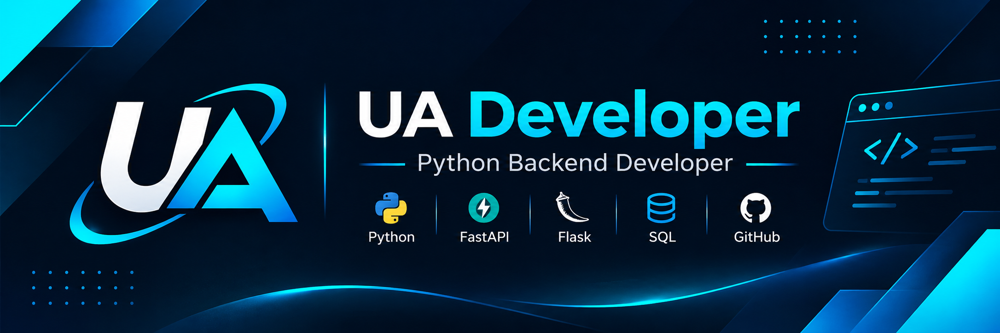

<h1 align="center">Ulugbek Abdullayev</h1>

<h3 align="center">
Aspiring Python Backend Developer
</h3>

Building practical software | Learning backend engineering

---

## About Me

- Information Systems and Technologies student.
- Focused on Python backend development.
- Building practical full-stack applications.
- Interested in software architecture and databases.
- Open to junior and internship opportunities.

## Technology Stack

---

## Featured Projects

### EduCore CRM Pro

Education management platform.

- REST API with FastAPI
- Role-based access control
- Student and course management
- Attendance and payment tracking
- SQLite database
- Automated testing

[View Repository](https://github.com/ula24-03/educore-crm-pro)

### DevTask Manager

Developer task management application.

- Flask backend
- CRUD operations
- SQLite database
- Responsive dashboard
- Automated API tests

[View Repository](https://github.com/ula24-03/devtask-manager)

### PC System Monitor

Real-time computer resource monitoring dashboard.

- CPU monitoring
- Memory and disk usage
- Performance visualization
- Python and psutil

[View Repository](https://github.com/ula24-03/pc-system-monitor)

---

## Engineering Skills

- REST API development
- Relational database design
- Authentication and authorization
- Input validation
- Automated testing
- Git version control
- GitHub Actions
- Technical documentation

## Currently Learning

- PostgreSQL
- SQLAlchemy
- Alembic
- Docker
- Clean Architecture
- Design Patterns
- Data Structures and Algorithms

## Development Environment

- Windows
- Linux
- Android Termux
- Visual Studio Code

## Development Approach

I build educational and portfolio projects,
including AI-assisted development.

My focus is understanding the code, testing
its behavior, improving its quality, and
developing independent engineering skills.

---

Learning. Building. Improving.

